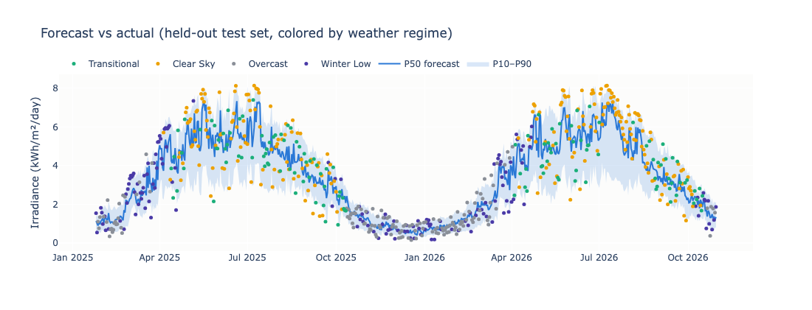
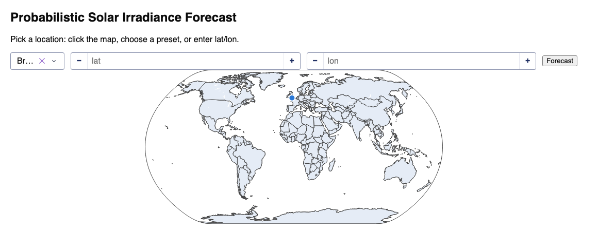
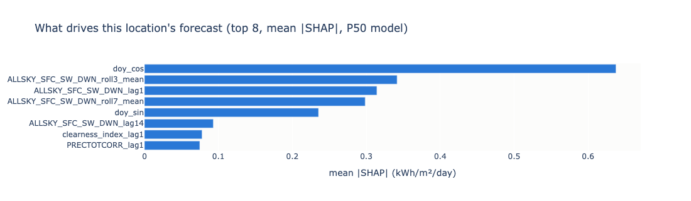

# Solar Irradiance Forecasting

Probabilistic solar irradiance forecasting for any location on Earth, built on
[NASA POWER](https://power.larc.nasa.gov/) daily data. Pick a point by map
click, preset, or manual lat/lon and the app returns a next-day P10/P50/P90
forecast fit on that location's own history. It also shows baselines,
uncertainty bands, a weather-regime error breakdown, and SHAP explanations.



## How it works

- **Per-location fetch and fit.** On request, the app fetches NASA POWER daily
  history since 2015 (about 11 years) for that lat/lon, caches it, and fits
  baselines and LightGBM on the spot. The fit takes seconds. The API fetch is
  the slow part, so repeat requests are instant. A cache older than 10 days
  (measured against its last observed day) is refetched in full on next
  access. If that refetch fails, the stale cache is served with a warning, so
  a live demo gets slightly old data instead of an error.
- **Four pre-cached presets:** Bristol (temperate/mixed), Phoenix
  (sunny/arid), Bergen (cloudy/wet), and Kuala Lumpur (equatorial/humid). A
  live demo never waits on the NASA POWER API.
- **Models.** Persistence and Ridge baselines set the floor. LightGBM
  quantile regression (P10/P50/P90) is the headline model. A single-layer
  LSTM with attention is a deep-learning comparison for the four presets
  (see Sequence model vs LightGBM below); it is optional and trained offline.
- **Analysis.** KMeans weather-regime clustering (Clear Sky, Overcast,
  Transitional, Winter Low) drives a per-regime RMSE breakdown. Locations
  without a real seasonal cycle, like Kuala Lumpur, get the neutral "Low
  Irradiance" label instead of "Winter Low". SHAP gives feature importance
  and per-prediction explanations.
- **One code path.** `src/pipeline.py` is the single function that fetches
  data, builds features, fits, and predicts. The offline training script and
  the live dashboard both call it, so they cannot drift apart.

## Quickstart

```bash
pip install -r requirements.txt   # macOS: also `brew install libomp` for LightGBM

# Optional but recommended before launching (and before any live demo):
# warm the caches + fit models for the four presets, print metrics
python -m src.train

# Launch the web app at http://127.0.0.1:8050
python dashboard/app.py

# Run the test suite (synthetic data only, no network)
python -m pytest tests/
```

The LSTM needs PyTorch, which is an optional extra: `pip install -r
requirements-seq.txt`, then rerun `python -m src.train`. Without it, training
skips the LSTM and the dashboard shows LightGBM only.



The uncertainty band is the model's P10-P90 quantile forecast. Its measured
coverage on held-out data is 0.73-0.77 against a nominal 0.80. The dashboard
shows that figure in the caption and in a per-location coverage tile instead
of calling the band an "80% confidence interval".

## Results

Next-day forecasts on each location's held-out test set (kWh/m²/day),
regenerated 2026-07-15. Splits are chronological (70/15/15). Each preset
trains on 2015 to early 2023 and keeps a validation slice of about 626 days
between train and test. That slice was used once, by the one-off
hyperparameter tuning in `src/tune.py`, and the winning params are reused
unchanged everywhere. Evaluation uses the most recent ~626 days:

| Location | Train window | Test window | Test days | Measured P10-P90 coverage |
|---|---|---|---|---|
| Bristol, UK (temperate/mixed) | 2015-01-30 to 2023-01-23 | 2024-10-10 to 2026-07-09 | 626 | 0.730 |
| Phoenix, AZ, USA (sunny/arid) | 2015-01-30 to 2023-02-01 | 2024-10-21 to 2026-07-09 | 627 | 0.756 |
| Bergen, Norway (cloudy/wet) | 2015-01-30 to 2023-01-23 | 2024-10-10 to 2026-07-09 | 626 | 0.765 |
| Kuala Lumpur, MY (equatorial/humid) | 2015-01-30 to 2023-01-27 | 2024-10-15 to 2026-07-08 | 626 | 0.740 |

Coverage is the fraction of test-set actuals that fall inside the P10-P90
band (nominal 0.80). Test windows end about 6 days before the fetch date
because NASA POWER's near-real-time feed lags 5-7 days.

### Bristol, UK

| Model | RMSE | MAE | Pinball (P10/P50/P90) |
|---|---|---|---|
| Persistence | 1.199 | 0.834 | - |
| Ridge | **0.978** | 0.735 | - |
| LightGBM (P50) | 0.985 | **0.725** | 0.164 / 0.362 / 0.132 |

### Phoenix, AZ, USA

| Model | RMSE | MAE | Pinball (P10/P50/P90) |
|---|---|---|---|
| Persistence | 0.989 | 0.587 | - |
| Ridge | **0.809** | 0.534 | - |
| LightGBM (P50) | 0.836 | **0.486** | 0.180 / 0.243 / 0.072 |

### Bergen, Norway

| Model | RMSE | MAE | Pinball (P10/P50/P90) |
|---|---|---|---|
| Persistence | 1.182 | 0.736 | - |
| Ridge | **0.955** | 0.643 | - |
| LightGBM (P50) | 0.958 | **0.613** | 0.135 / 0.307 / 0.126 |

### Kuala Lumpur, MY

| Model | RMSE | MAE | Pinball (P10/P50/P90) |
|---|---|---|---|
| Persistence | 1.100 | 0.825 | - |
| Ridge | **0.846** | 0.638 | - |
| LightGBM (P50) | 0.854 | **0.636** | 0.179 / 0.318 / 0.119 |

The same fixed hyperparameters hold up off-preset. On Nairobi, Kenya
(equatorial, not pre-cached, re-measured 2026-07-15), LightGBM reaches RMSE
0.776 against 0.805 for Ridge and 0.926 for persistence, with measured band
coverage of 0.765 over 626 test days. LightGBM's P50 optimizes absolute
error, which is why it wins MAE at every location while Ridge stays slightly
ahead on RMSE.

### Per-regime RMSE breakdown

Per-regime error is the main lens for error analysis. The table splits
LightGBM P50 error by weather regime, where regimes are KMeans clusters
refit per location (the error analysis below covers the naming caveats).

| Location | Regime | Days | RMSE | MAE |
|---|---|---|---|---|
| Bristol | Overcast | 207 | 0.513 | 0.376 |
| Bristol | Winter Low | 163 | 0.760 | 0.564 |
| Bristol | Transitional | 103 | 1.240 | 1.012 |
| Bristol | Clear Sky | 153 | 1.402 | 1.175 |
| Phoenix | Winter Low | 220 | 0.661 | 0.402 |
| Phoenix | Clear Sky | 154 | 0.797 | 0.469 |
| Phoenix | Transitional | 188 | 0.979 | 0.493 |
| Phoenix | Overcast | 65 | 0.993 | 0.791 |
| Bergen | Overcast | 249 | 0.307 | 0.183 |
| Bergen | Winter Low | 115 | 0.773 | 0.505 |
| Bergen | Transitional | 152 | 1.238 | 0.996 |
| Bergen | Clear Sky | 110 | 1.506 | 1.172 |
| Kuala Lumpur | Low Irradiance | 127 | 0.730 | 0.572 |
| Kuala Lumpur | Transitional | 152 | 0.863 | 0.621 |
| Kuala Lumpur | Clear Sky | 219 | 0.863 | 0.626 |
| Kuala Lumpur | Overcast | 128 | 0.937 | 0.736 |

`python -m src.train` regenerates these tables and the SHAP feature-importance
artifacts into `artifacts/`. The dashboard also computes a SHAP panel on each
request:



## Sequence model vs LightGBM

The phase-4 comparison model is a single-layer LSTM (hidden size 32) with
attention over a 30-day window of the same 16 engineered features, trained
with pinball loss on P10/P50/P90. For the four presets it is fit offline by
`python -m src.train` and the dashboard reads the saved forecasts. For custom
locations the dashboard fits it live, which adds about 5 seconds on top of the
LightGBM fit and needs the optional torch install. Either way its P50 is drawn
as a dashed second line.

This table comes from the 2026-11-04 run, after the caches refreshed, so its
test windows differ from the tables above and the LightGBM figures differ
slightly from them. Both models are scored on the same 644 days. Each cell
reads LightGBM / LSTM.

| Location | Test window | RMSE | MAE | Pinball P10 / P50 / P90 (LightGBM) | Pinball P10 / P50 / P90 (LSTM) | P10-P90 coverage |
|---|---|---|---|---|---|---|
| Bristol, UK | 2025-01-25 to 2026-10-30 | 1.022 / 1.152 | 0.793 / 0.892 | 0.187 / 0.396 / 0.144 | 0.192 / 0.446 / 0.161 | 0.728 / 0.789 |
| Phoenix, AZ, USA | 2025-01-25 to 2026-10-30 | 0.922 / 1.033 | 0.553 / 0.639 | 0.202 / 0.277 / 0.085 | 0.239 / 0.320 / 0.094 | 0.728 / 0.792 |
| Bergen, Norway | 2025-01-25 to 2026-10-30 | 1.032 / 1.114 | 0.725 / 0.804 | 0.150 / 0.363 / 0.149 | 0.150 / 0.402 / 0.172 | 0.753 / 0.758 |
| Kuala Lumpur, MY | 2025-01-25 to 2026-10-30 | 0.820 / 0.872 | 0.616 / 0.664 | 0.170 / 0.308 / 0.112 | 0.182 / 0.332 / 0.122 | 0.734 / 0.773 |

LightGBM wins on RMSE, MAE, and P50 pinball loss at all four locations, by 5
to 12 percent on RMSE. The LSTM's band is closer to the nominal 0.80 coverage
at Bristol, Phoenix, and Kuala Lumpur (0.77 to 0.79), but its median is less
accurate, so the narrower-looking win on coverage does not make it the better
forecast. In the dashboard the LSTM line is visibly smoother than LightGBM's
and follows the seasonal curve while missing many day-to-day swings. A
plausible reading is that the 16 features already summarize the recent past
well, so a 30-day window adds little for a model trained on about 4,000
daily rows per location. That reading is untested.

The LSTM is the comparison the project set out to make, and it did not need to
win. LightGBM stays the headline model.

## Error analysis

### Where LightGBM helps

LightGBM's P50 beats both baselines on MAE at all four presets and at
Nairobi. Ridge stays slightly ahead on RMSE everywhere, by 0.003 to 0.027.
That follows from the training objective: the P50 is trained on pinball loss,
which optimizes absolute error, so it wins MAE and gives up a sliver of RMSE
to the least-squares baseline. The main value is the calibrated P10-P90
band, which neither baseline provides.

### Where it struggles, by regime

Absolute error follows irradiance level and volatility. At Bristol and
Bergen the easiest stratum is Overcast (RMSE 0.51 and 0.31), since dim days
leave little room to miss. The hardest is the high-irradiance Clear Sky
stratum (1.40 and 1.51), with Transitional close behind at about 1.24. A
bright day that follows mixed weather is where the lag-driven features fail,
and where the uncertainty band matters most.

Phoenix reverses the temperate pattern. Its stable winter is the easiest
regime (0.66), and its rare Overcast days (65 of 627) are the hardest
(0.99), so the regimes a location seldom sees are the ones its model handles
worst. Kuala Lumpur has the narrowest spread (0.73 to 0.94). With no
seasonal cycle, day-to-day equatorial convection dominates and regime
membership says less.

### Calibration

The original hand-picked LightGBM params undercovered: the "P10-P90" band
held only about 0.62-0.68 of held-out actuals. A one-off tuning pass
(`src/tune.py`, objective pinball loss, coverage tracked as a diagnostic)
settled on strongly regularized params that measure 0.73-0.77 across the
presets. That is close enough to the nominal 0.80 that no conformal
post-hoc step was added. This was decided by measurement, and it is why the
dashboard and this README cite measured coverage instead of claiming "80%
confidence".

### Known limitations

- Regime names are location-relative strata, not absolute weather classes.
  The naming heuristic ranks clusters within one location, so the same label
  means different weather in different climates. At Phoenix the cluster
  named "Transitional" has the highest mean irradiance (7.6 kWh/m²/day
  against 6.4 for its "Clear Sky"). Read the labels as ordered strata for
  error analysis, not as meteorology.
- "Today" is really today minus about 6 days. NASA POWER's near-real-time
  feed lags 5-7 days, so the most recent forecastable day trails the
  calendar by about a week, and test windows end about 6 days before their
  fetch date.
- Per-location fitting gives up cross-location learning. Each model sees
  only one point's roughly 11-year history, so a first request to a new
  location pays the fetch latency, and nothing transfers from data-rich to
  data-poor regions. I chose this over a global model (see Future work)
  because the per-location fit runs in seconds and keeps the scope small.

## Future work

- **Global multi-location model:** one model conditioned on lat/lon/climate,
  with instant inference anywhere. It is deferred because it needs a cleaned
  multi-location training corpus and a model that conditions well on
  geography, which is bigger and riskier than per-location fits that already
  run in seconds.
- **Free-text place-name input:** not built, to avoid a geocoding dependency.
  The map click, preset, and manual lat/lon inputs cover the demo. Adding it
  later would take a free geocoding API and no rearchitecture.
- **TFT-lite variant:** the LSTM above has no input gating. Adding gated
  variable selection would show whether that machinery helps on this data. It
  would still run on the demo locations only, since training a deep model per
  request is too slow for interactive use.

## Repo layout

See `CLAUDE.md` for the full architecture guide. In short, `config.py` is the
single source of truth for features, paths, and demo locations. `src/` holds
the data layer, models, clustering, SHAP, and the shared pipeline.
`dashboard/` is the Plotly Dash app, with pure helpers in
`dashboard/helpers.py`. `tests/` is a network-free pytest suite that runs on
synthetic data. `notebooks/eda.ipynb` is exploratory only.
