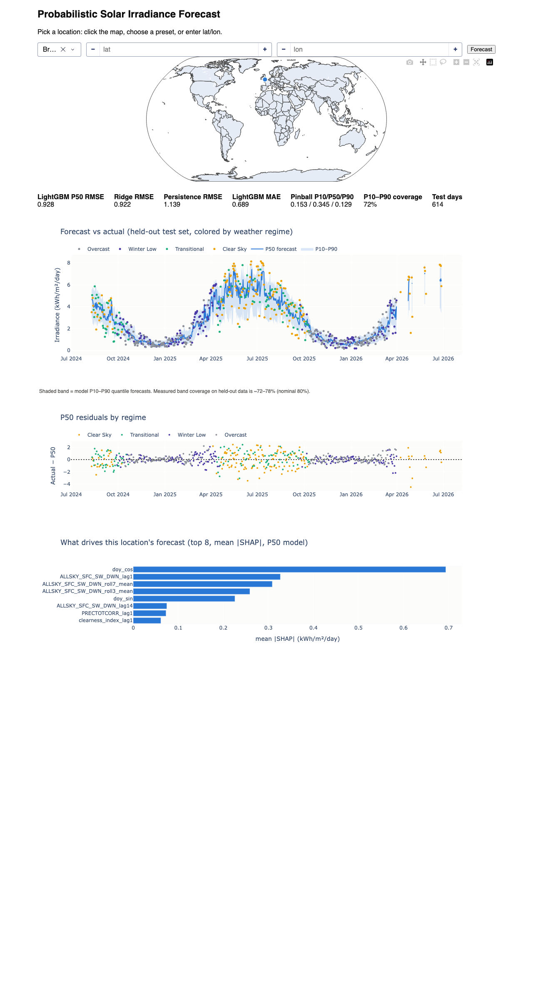

# Solar Irradiance Forecasting

Probabilistic solar irradiance forecasting for **any location on Earth**, using
[NASA POWER](https://power.larc.nasa.gov/) daily data. Enter a lat/lon (map
click, preset, or manual entry) and get a next-day P10/P50/P90 forecast fit
on that location's own history — with baselines, uncertainty bands, weather-
regime error analysis, and SHAP explanations.



## How it works

- **Per-location fetch-and-fit:** on request, the app fetches (and caches)
  ~10 years of NASA POWER history for that lat/lon and fits baselines +
  LightGBM on the spot. The fit takes seconds; the API fetch is the latency
  bottleneck, so repeat requests are instant.
- **Models:** persistence and Ridge baselines (the floor), LightGBM quantile
  regression (P10/P50/P90, the headline model), and an optional attention
  LSTM / TFT-lite comparison model (stretch).
- **Analysis:** KMeans weather-regime clustering (Clear Sky / Overcast /
  Transitional / Winter Low) drives a per-regime RMSE breakdown, plus SHAP
  feature importance and per-prediction explanations.
- **One code path:** `src/pipeline.py` is the single fetch → features → fit →
  predict function; both the offline training script and the live dashboard
  call it, so the two can never drift.

## Quickstart

```bash
pip install -r requirements.txt   # macOS: also `brew install libomp` for LightGBM

# Warm the cache + fit models for the demo locations, print metrics
python -m src.train

# Launch the web app at http://127.0.0.1:8050
python dashboard/app.py
```

The dashboard labels its uncertainty band honestly: it is the model's
P10–P90 quantile forecast, whose **measured** coverage on held-out data is
0.73–0.77 (nominal 0.80) — shown in the caption and per-location coverage
tile rather than marketed as an "80% confidence interval".

## Results

Next-day forecasts on each location's held-out test set (kWh/m²/day),
regenerated 2026-07-15. Splits are chronological (70/15/15): each preset
trains on 2015 → early 2023, keeps a ~626-day validation slice between train
and test (used once, by the one-off hyperparameter tuning in `src/tune.py` —
the winning params are reused fixed everywhere), and is evaluated on the most
recent ~626 days:

| Location | Train window | Test window | Test days | Measured P10–P90 coverage |
|---|---|---|---|---|
| Bristol, UK (temperate/mixed) | 2015-01-30 → 2023-01-23 | 2024-10-10 → 2026-07-09 | 626 | 0.730 |
| Phoenix, AZ, USA (sunny/arid) | 2015-01-30 → 2023-02-01 | 2024-10-21 → 2026-07-09 | 627 | 0.756 |
| Bergen, Norway (cloudy/wet) | 2015-01-30 → 2023-01-23 | 2024-10-10 → 2026-07-09 | 626 | 0.765 |
| Kuala Lumpur, MY (equatorial/humid) | 2015-01-30 → 2023-01-27 | 2024-10-15 → 2026-07-08 | 626 | 0.740 |

Coverage is the measured fraction of test-set actuals falling inside the
P10–P90 band (nominal 0.80). Test windows end ~6 days before the fetch date
because NASA POWER's near-real-time feed lags ~5–7 days.

**Bristol, UK**

| Model | RMSE | MAE | Pinball (P10/P50/P90) |
|---|---|---|---|
| Persistence | 1.199 | 0.834 | – |
| Ridge | **0.978** | 0.735 | – |
| LightGBM (P50) | 0.985 | **0.725** | 0.164 / 0.362 / 0.132 |

**Phoenix, AZ, USA**

| Model | RMSE | MAE | Pinball (P10/P50/P90) |
|---|---|---|---|
| Persistence | 0.989 | 0.587 | – |
| Ridge | **0.809** | 0.534 | – |
| LightGBM (P50) | 0.836 | **0.486** | 0.180 / 0.243 / 0.072 |

**Bergen, Norway**

| Model | RMSE | MAE | Pinball (P10/P50/P90) |
|---|---|---|---|
| Persistence | 1.182 | 0.736 | – |
| Ridge | **0.955** | 0.643 | – |
| LightGBM (P50) | 0.958 | **0.613** | 0.135 / 0.307 / 0.126 |

**Kuala Lumpur, MY**

| Model | RMSE | MAE | Pinball (P10/P50/P90) |
|---|---|---|---|
| Persistence | 1.100 | 0.825 | – |
| Ridge | **0.846** | 0.638 | – |
| LightGBM (P50) | 0.854 | **0.636** | 0.179 / 0.318 / 0.119 |

The same fixed hyperparameters hold up off-preset — e.g. Nairobi, Kenya
(equatorial, not pre-cached, re-measured 2026-07-15): LightGBM RMSE 0.776 vs
Ridge 0.805 vs persistence 0.926, with measured band coverage 0.765 over 626
test days. LightGBM's P50 optimizes absolute error, which is why it wins MAE
at every location while Ridge stays marginally ahead on RMSE.

### Per-regime RMSE breakdown

The primary error-analysis lens (per CLAUDE.md's evaluation conventions):
LightGBM P50 error split by weather regime, where regimes are KMeans clusters
refit per location (see the error-analysis notes below for naming caveats).

| Location | Regime | Days | RMSE | MAE |
|---|---|---|---|---|
| Bristol | Overcast | 207 | 0.513 | 0.376 |
| Bristol | Winter Low | 163 | 0.760 | 0.564 |
| Bristol | Transitional | 103 | 1.240 | 1.012 |
| Bristol | Clear Sky | 153 | 1.402 | 1.175 |
| Phoenix | Winter Low | 220 | 0.661 | 0.402 |
| Phoenix | Clear Sky | 154 | 0.797 | 0.469 |
| Phoenix | Transitional | 188 | 0.979 | 0.493 |
| Phoenix | Overcast | 65 | 0.993 | 0.791 |
| Bergen | Overcast | 249 | 0.307 | 0.183 |
| Bergen | Winter Low | 115 | 0.773 | 0.505 |
| Bergen | Transitional | 152 | 1.238 | 0.996 |
| Bergen | Clear Sky | 110 | 1.506 | 1.172 |
| Kuala Lumpur | Low Irradiance | 127 | 0.730 | 0.572 |
| Kuala Lumpur | Transitional | 152 | 0.863 | 0.621 |
| Kuala Lumpur | Clear Sky | 219 | 0.863 | 0.626 |
| Kuala Lumpur | Overcast | 128 | 0.937 | 0.736 |

These tables and the SHAP feature-importance artifacts are regenerated into
`artifacts/` by `python -m src.train`.

## Repo layout

See `CLAUDE.md` for the full architecture guide. In short: `config.py` is the
single source of truth for features/paths/demo locations; `src/` holds the
data layer, models, clustering, SHAP, and the shared pipeline; `dashboard/`
is the Plotly Dash app; `notebooks/eda.ipynb` is exploratory only.
